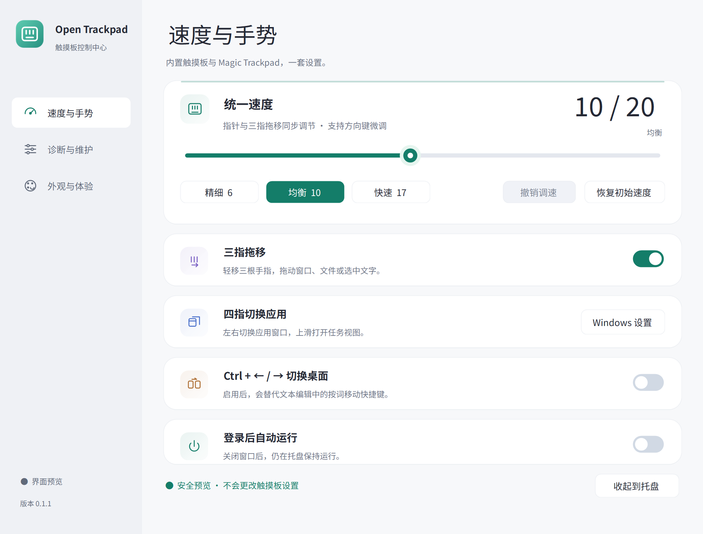
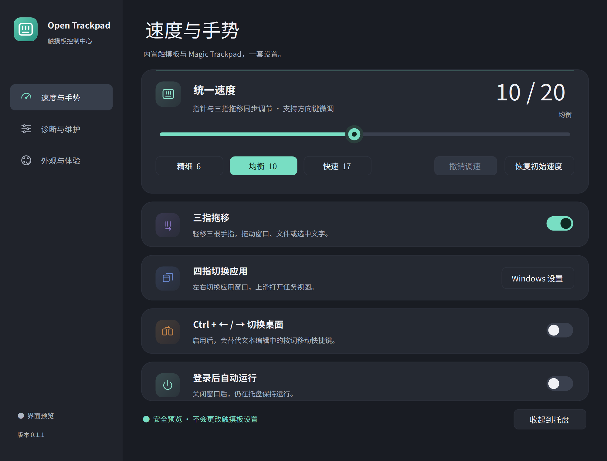

# Open Trackpad

一个轻量的 Windows 精确式触摸板控制中心：统一指针与三指拖移速度、管理手势和可选快捷键，并用同一套界面查看状态与维护信息。应用在本机运行，不需要账号或网络服务。

## 界面预览

浅色与深色界面均为独立安全预览，显示模拟状态；截图不包含真实设备资料。




## 使用

解压便携包后打开 `OpenTrackpad.exe`。关闭设置窗口会收起到系统托盘；从托盘选择退出才会停止手势组件。`OpenTrackpad.DriverPanel.exe` 是可选的驱动维护窗口，日常调速不需要打开它。

- **速度与手势**：统一速度滑块、精细／均衡／快速预设、撤销最近调速、三指拖移开关及可选的虚拟桌面快捷键。拖动时预览，松手后应用；Esc 取消尚未应用的调整。
- **外观与体验**：深浅主题和本机字体方案。先预览，确认后保存；取消保留原设置。
- **诊断与维护**：查看输入状态与错误详情，按需开启详细日志。无需为了日常使用阅读底层报告。
- 设置页内可用 `Ctrl+1`、`Ctrl+2`、`Ctrl+3` 切换页面并聚焦主要控件；外观页支持 `Ctrl+S` 保存。选择器支持方向键、Home／End 和 F4，开关可用空格操作。启用 `Ctrl+←/→` 桌面切换后，它会占用文本中的按词移动；可随时关闭。

三指放下后轻移可以拖动窗口、文件或选择文字；静止放下不会点击，抬指会结束拖移。四指操作由 Windows 原生手势负责。普通权限应用无法操控某些管理员窗口，可按实际需要选择管理员模式。

首次使用时，在“诊断与维护”中选择“应用手势配置”。应用会先保留原始手势设置，再配置三指拖移所需的 Windows 选项；如果 Windows 尚未应用，界面会显示等待状态。是否登录启动、是否启用桌面快捷键由各自开关控制。

准备停止使用时，可以先选择“恢复原生手势”，再退出托盘应用并移除便携程序目录。原始手势备份和用户资料保留在资料目录，更新或移除程序文件不会自动删除它们。

## 0.1.1 的改进

- 原创触摸板标识统一到侧栏、窗口、托盘与快捷方式，提供 9 种 Windows 图标尺寸和 SVG 源文件。
- 窄窗口的速度按钮与外观选择器自动分行；诊断页使用清楚的运行状态、随主题与字体显示的记录，以及分组操作。
- 补齐键盘与辅助技术操作；恢复失败保留原选项，监听失败持续提示并重试，异常详情留在本机日志。

## 系统与设备

主要目标为 Windows 11 x64 和 .NET Framework 4.8。需要系统可以识别的精确式触摸板及可用的 HID 报告；设备兼容性以实际检测为准。原有实现曾在 Magic Trackpad 2 和一块内置触摸板上验证，其他型号仍需实机验收。

Magic Trackpad 需要已有可用的精确式触摸板驱动。这个源码仓库与默认便携包不附带内核驱动、商业软件安装器或旧驱动恢复备份。维护窗口检测不到受信任驱动包时，不能执行驱动切换；已经装好驱动的设备可以直接使用日常应用。

可选驱动项目：[MagicTrackpad2ForWindows](https://github.com/vitoplantamura/MagicTrackpad2ForWindows)。它是独立的 GPLv2 项目，请按其自身说明安装和查看对应源码。Open Trackpad 不会自动重启 Windows。

## 本机资料

设置与恢复副本位于 `%LOCALAPPDATA%\OpenTrackpad\state`，日志位于 `%LOCALAPPDATA%\OpenTrackpad\logs`。程序目录可以只读，更新应用文件不会覆盖用户资料。旧版分发目录中的原始配置和恢复材料应单独保留。

从旧原型升级时，先从旧版托盘菜单退出，保留完整旧目录，再打开新的 `OpenTrackpad.exe`。新旧普通实例使用同一个实例标识，打开新文件不会自动替换已经运行的旧程序；看到旧窗口时，不能把它当作新版本已经启动。需要登录启动时，在新版中重新启用该选项以更新程序路径；如果它显示已开启，可先关闭再开启。

较早的原型备份可能没有完整记录 Windows 原生轻点拖移的原值，这类快照会拒绝自动恢复全部选项。请保留旧目录，并在 Windows 触摸板设置中手动确认原选项。

`OpenTrackpad.exe --preview` 可打开独立预览，不启用真实手势。`OPENTRACKPAD_DATA_DIR` 可指定独立资料根目录；这个模式使用独立实例标识，以隔离模型模拟速度、手势与启动项操作，禁止真实的全局输入监听、键鼠注入和系统设置写入，也不会迁移正常用户资料。不要把隔离模式当作真实手势已经生效的证据。

普通启动可通过 `OPENTRACKPAD_LEGACY_DIR` 指定旧程序根目录，按允许清单导入旧手势选项、原始设置和窗口配置；已有的新资料不会被覆盖。驱动恢复元数据只作为本机迁移记录保留，商业安装器和驱动备份不会被复制到新包。新用户的桌面快捷键默认关闭，旧配置保留原选择；应用手势配置不会重新打开登录启动或桌面快捷键，恢复原生手势则会明确关闭登录启动。

## 构建

在 Windows x64 上使用自带 .NET Framework C# 编译器，不需要下载 NuGet 包或额外的 UI 运行时：

```powershell
./scripts/Build.ps1
```

输出在 `build/`，包含日常应用、维护窗口和维护脚本。版本统一来自 `version.json`、`src/AssemblyInfo.cs` 与应用 manifest；不一致时构建会停止。

图标由项目自己的矢量绘制代码生成；运行 `scripts/Generate-Icon.ps1` 可重建 `src/OpenTrackpad.ico`、SVG 和各尺寸预览，无需额外依赖。

## 验证与打包

```powershell
./scripts/Verify-Source.ps1
./scripts/Verify.ps1
./scripts/Verify-Ui.ps1
./scripts/Verify-Controller.ps1
./scripts/Package.ps1
```

`Verify.ps1` 运行确定性的拖移、按键释放、调速草稿与撤销测试，再运行隔离的配置恢复与运行状态测试。它不要求触摸板硬件，不写 Windows 设置，不安装驱动，不注入全局输入。CI 只运行这一层和干净源码检查。

`Verify-Ui.ps1` 是独立预览检查，不启动常驻手势控制器；使用独立资料验证导航、控件、外观与布局。需要 Windows 图形会话。 加上 `-LayoutMatrix` 可遍历已安装字体、深浅主题、三个页面与两种窗口尺寸，并按实际 DPI 记录布局边界及自身窗口截图。实体手指的拖移手感、蓝牙断开重连、睡眠恢复等仍属于实机验收，不会被截图或模拟报告替代。

`Verify-Controller.ps1` 在独立资料下运行真实控制器，检查模拟调速、选项、同资料单实例、不同资料隔离、管理员重启拒绝、并发配置写入和退出清理。它需要 Windows 图形会话；所有子进程均使用本轮隔离资料，不会唤起普通实例或接管真实触摸板。管理员负例执行前，脚本会先拒绝缺少已审查隔离门控的旧源码。

旧源码中的某些 `--test-speed*`、`--set-speed`、`--restore-speed` 诊断会更改真实系统速度。通用验证入口不调用它们。不要将这些实机诊断直接放进 CI。

打包结果位于 `artifacts/`：便携 ZIP、干净源码 ZIP 和 `SHA256SUMS.txt`。源码包使用允许清单，并拒绝真实资料、日志、恢复安装器、编译产物和绝对用户路径。PNG 仅允许放在 `docs/screenshots/`，截图不加入便携运行包。包内每个文件都与输入文件重新校验 SHA256。

## 提交到 GitHub

只提交这个干净源码目录。不要复制旧分发目录中的 `state/`、`logs/`、`analysis/`、`recovery/`、驱动备份或安装器；它们可能包含本机设备标识和个人设置。构建产物放在 Release 附件中，不混入源码提交。先运行上述验证，再检查 `git status` 后自行提交。

## 许可证与来源

项目采用 MIT 许可。三指拖移基于 [yuyisheshen/ThreeFingerDrag-Windows](https://github.com/yuyisheshen/ThreeFingerDrag-Windows) 的 MIT 实现，完整版权声明保存在 `licenses/ThreeFingerDrag-MIT.txt`。第三方边界见 [THIRD-PARTY-NOTICES.md](THIRD-PARTY-NOTICES.md)。
